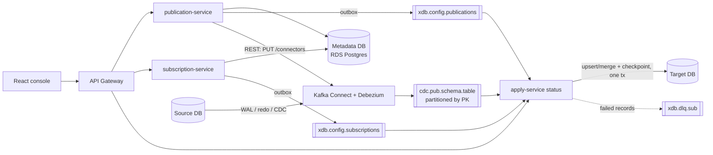

# xDB Replication Platform (modernized)

A cloud-native, event-driven rebuild of the xDB Replication Server. It replicates data from
**PostgreSQL / EPAS / Oracle / SQL Server** sources to **PostgreSQL / EPAS / Oracle / SQL Server**
targets, using **Debezium CDC on Kafka Connect**, **Apache Kafka** topics and **Spring Boot
microservices**. It is configured from a **React** console and deployed with **Docker**,
**Kubernetes (EKS)** and **Terraform on AWS**.

```
Java 17+ (built and run on 21) · Spring Boot 3.4 · Spring Cloud Gateway · Spring Kafka · Debezium 2.7
Kafka 3.8 / Amazon MSK · PostgreSQL (metadata) · React 18 + TypeScript + Vite · Docker · Kubernetes · Terraform
```

---

## Contents

1. [Legacy vs modernized](#1-legacy-vs-modernized)
2. [Architecture and flow](#2-architecture-and-flow)
3. [End-to-end walkthrough](#3-end-to-end-walkthrough)
4. [How Kafka, Kafka Connect and Debezium process changes](#4-how-kafka-kafka-connect-and-debezium-process-changes)
5. [Consumer side: partitions, offsets, ordering, delivery guarantees](#5-consumer-side-partitions-offsets-ordering-delivery-guarantees)
6. [Failure handling](#6-failure-handling)
7. [Scaling to hundreds of tables (e.g. 500)](#7-scaling-to-hundreds-of-tables-eg-500)
8. [Design patterns](#8-design-patterns)
9. [AWS and Kubernetes](#9-aws-and-kubernetes)
10. [Running locally](#10-running-locally)
11. [REST API](#11-rest-api)
12. [Project structure](#12-project-structure)
13. [Limitations and roadmap](#13-limitations-and-roadmap)

---

## 1. Legacy vs modernized

The legacy product was a single Java application. A Swing GUI/CLI talked over **RMI** to a
replication engine, which captured changes with **triggers + shadow tables** or **WAL logical
decoding**. A **Quartz** scheduler pushed batches every 1–5 seconds; an **MTK** run did the initial
snapshot; all configuration lived in an xDB control schema.

| Legacy xDB | Modernized | Why it is better |
|---|---|---|
| Rep CLI / Swing GUI | React console + REST, behind an **API Gateway** | Browser-based, scriptable, one origin, auth at the edge |
| Monolithic Java app + **RMI** | **Microservices**: publication, subscription, apply | Independent deploy and scaling; no RMI firewall/port issues |
| Configuration logic + xDB control schema | **Metadata store** (RDS Postgres, schema per service) + compacted **config topics** | Services stay decoupled; config is replayable |
| Triggers + shadow tables / WAL decoding inside xDB | **Debezium** connectors on **Kafka Connect** (log-based for all 4 engines) | No triggers on the source, minimal source overhead, one CDC model |
| Quartz polling every 1–5 s | Continuous streaming | Lower latency, no empty polls |
| MTK snapshot | Debezium `snapshot.mode=initial` (+ parallel snapshot threads) | Consistent snapshot handed off to streaming at an exact log position |
| RMI apply into target | **Kafka topics → apply-service consumer groups → target** | Durable buffer, replay, back-pressure, horizontal scale |
| Single process | Stateless pods on **EKS**, HA Kafka Connect, Multi-AZ MSK/RDS | Survives node and AZ failures |

This build implements **single-master replication (SMR)**. Multi-master (MMR) conflict
resolution is out of scope (see [roadmap](#13-limitations-and-roadmap)).

---

## 2. Architecture and flow

```
                         User / UI / API Client
                                   |
                                   v
                               API Gateway                 (Spring Cloud Gateway: routing, CORS, JWT, retry, circuit breaker)
                                   |
                    ┌──────────────┴──────────────┐
                    |                             |
                    v                             v
           Publication APIs              Subscription APIs
                    |                             |
                    v                             v
           Publication Service           Subscription Service
                    |                             |
                    | configuration               | configuration
                    v                             v
                Metadata / Configuration Store  (RDS Postgres: schema "publication" + schema "subscription")
                    |      + compacted Kafka topics xdb.config.publications / xdb.config.subscriptions
                    |
                    | registers Debezium connector (Kafka Connect REST)
                    +----------------------------------+
                                                       |
   SOURCE SIDE                                         | TARGET SIDE
                                                       |
   PostgreSQL / EPAS / Oracle / SQL Server             |
             |                                         |
             v                                         |
       CDC mechanism   (WAL+pgoutput | redo/LogMiner | SQL Server CDC tables)
             |                                         |
        Debezium source connector                      |
             |                                         |
        Kafka Connect (distributed workers)            |
             |                                         |
             v                                         |
        Kafka Topics   cdc.<pub>.<schema>.<table>      |
             |         key = primary key → partition   |
             | CDC Events                              |
             v                                         |
      Subscriber / Apply Service ----------------------+   (reads xdb.config.subscriptions)
             |
             | subscription configuration
             |
             +---- Which publication?        → topic pattern cdc.<pub>.*  + row filters
             |
             +---- Which target DB?          → JDBC pool + SQL dialect (upsert/merge)
             |
             +---- Which tables/mappings?    → source schema.table → target schema.table
             |
             v
   PostgreSQL / EPAS / Oracle / SQL Server
```



### Services

| Service | Port | Responsibility |
|---|---|---|
| `api-gateway` | 8080 | Single entry point. Routes `/api/**`, CORS, JWT (Cognito) on AWS, retry + circuit breaker. Never routes `/internal/**`. |
| `publication-service` | 8081 | Source DBs and publications. Builds the Debezium config per engine, registers it on Kafka Connect, reconciles connector state, drops Postgres replication slots on delete. |
| `subscription-service` | 8082 | Target DBs and subscriptions (publication, target, table mappings). Validates against publication-service. |
| `apply-service` | 8084 | Consumes CDC topics, one consumer group per subscription. Filters, maps and applies changes transactionally, commits offsets, retries, DLQ, metrics. Stateless. |
| `kafka-connect` | 8083 | Debezium source connectors, distributed mode. |
| `ui` | 3000 (local) | React console modelled on the legacy GUI. |
| `common` | – | Shared contracts: `ChangeEvent`, config events, outbox, secret stores, error handling. |

---

## 3. End-to-end walkthrough

The same six steps as the legacy console, mapped onto the new components.

| # | Legacy step | Modernized |
|---|---|---|
| 1 | **Add Publication DB** (host, port, user, password; WAL/Trigger; creates xDB control schema + triggers) | Console → `POST /api/source-databases`. Password goes to the **SecretStore** (AWS Secrets Manager); metadata stores a reference. **Test** runs a real JDBC check. No triggers or control schema on the source. |
| 2 | **Create Publication** (tables, filter, pubname) | `POST /api/publications`: tables, row filters, partitions, topic routing, snapshot mode. Saved together with an outbox event; then a **Debezium connector** `xdb-<pub>` is registered via `PUT /connectors/xdb-<pub>/config`. |
| 3 | **Add Subscription DB** | `POST /api/target-databases` (same as step 1, target side). |
| 4 | **Create Subscription** (subname → pubname) | `POST /api/subscriptions`: publication, target, table mappings (defaults to identity). A `SubscriptionEvent` goes to `xdb.config.subscriptions`. |
| 5 | **Snapshot / initial load (MTK)** | Debezium snapshots the tables (`snapshot.mode=initial`, `snapshot.max.threads`), emitting `op=r` events into the same topics, then switches to streaming at the exact log position. The apply side upserts snapshot rows like inserts. |
| 6 | **Synchronization** (manual / scheduled every 1–5 s) | Continuous. apply-service sees the subscription event, starts consumer group `xdb-apply-<sub>`, and applies every change as it arrives. |

### What happens inside, step by step

```
publication-service                              Kafka Connect / Debezium                  Kafka
───────────────────                              ────────────────────────                  ─────
POST /api/publications
 ├─ tx: INSERT publication + INSERT xdb_outbox(PublicationEvent)
 ├─ PUT /connectors/xdb-orders_pub/config  ───▶  start PostgresConnector task
 │                                               ├─ create slot xdb_orders_pub, publication xdb_orders_pub_pub
 │                                               ├─ snapshot tables (op=r) ───────────────▶ cdc.orders_pub.public.orders ...
 │                                               └─ stream WAL (op=c/u/d) ────────────────▶ (key = PK → partition)
 └─ OutboxRelay ───────────────────────────────────────────────────────────────────────────▶ xdb.config.publications

subscription-service
POST /api/subscriptions
 ├─ GET publication-service /api/publications/orders_pub (validate tables)
 ├─ tx: INSERT subscription + INSERT xdb_outbox(SubscriptionEvent)
 └─ OutboxRelay ───────────────────────────────────────────────────────────────────────────▶ xdb.config.subscriptions

apply-service (every pod)
 ├─ replays xdb.config.* from offset 0 → in-memory desired state
 ├─ subscription + publication known → start container:
 │     group   = xdb-apply-orders_sub
 │     topics  = cdc\.orders_pub\..+   (regex, picks up new table topics automatically)
 │     pool    = Hikari → target JDBC URL, password from Secrets Manager
 └─ loop: poll ≤ 500 records → adapt → filter → map → UPSERT/DELETE + checkpoint (1 tx) → commit offsets
```

---

## 4. How Kafka, Kafka Connect and Debezium process changes

### 4.1 Capture: one Debezium connector per publication

`publication-service` builds the connector config with a **Strategy** per engine
(`connect/strategy/*`) on top of a **Template Method** base that fixes the shared contract.

| Source | Debezium connector | CDC mechanism | Source prerequisites |
|---|---|---|---|
| PostgreSQL / EPAS | `PostgresConnector`, `plugin.name=pgoutput` | WAL logical decoding through a **replication slot** (`xdb_<pub>`) and a filtered Postgres publication | `wal_level=logical`, a user with `REPLICATION`; `REPLICA IDENTITY FULL` on tables with row filters |
| Oracle | `OracleConnector`, LogMiner adapter | Redo / archive logs mined by LogMiner | ARCHIVELOG, supplemental logging, LogMiner user; ojdbc driver in the Connect image |
| SQL Server | `SqlServerConnector` | SQL Server CDC change tables (filled from the transaction log by SQL Agent) | `sp_cdc_enable_db` and `sp_cdc_enable_table` |

Shared settings (all engines):

```properties
topic.prefix=cdc.<pub>                       # topics: cdc.<pub>.<schema>.<table>
key.converter / value.converter = JsonConverter, schemas.enable=false
tombstones.on.delete=false                   # one delete event, no tombstone
decimal.handling.mode=string                 # no precision loss across engines
time.precision.mode=connect                  # dates = epoch days, timestamps = epoch ms
snapshot.mode=initial, snapshot.max.threads=4
heartbeat.interval.ms=10000                  # keeps the slot advancing on idle sources
topic.creation.default.partitions=<n>        # partitions per table topic
producer.override.compression.type=lz4, linger.ms=20, batch.size=256KB
```

You can see the exact generated config (password masked) with
`GET /api/publications/{name}/connector-config`.

### 4.2 Kafka Connect: where progress lives

Kafka Connect runs in **distributed mode** (2–3 workers on EKS). Three internal compacted topics hold:

- `xdb_connect_configs`: connector configs
- `xdb_connect_offsets`: the **source position** (Postgres LSN, Oracle SCN, SQL Server LSN)
- `xdb_connect_statuses`: connector and task state

If a worker dies, its task is rebalanced to another worker, which resumes from the stored source
offset. On Postgres the slot also keeps the WAL until Debezium confirms it, so nothing is lost
across restarts.

### 4.3 The event on the topic

```json
key:   {"id": 100}
value: {
  "before": {"id": 100, "status": "NEW",  "total": "150.00", ...},
  "after":  {"id": 100, "status": "PAID", "total": "150.00", ...},
  "source": {"connector": "postgresql", "schema": "public", "table": "orders", "txId": 991, "lsn": 24023128, "ts_ms": 1760000000000},
  "op": "u",
  "ts_ms": 1760000000100
}
```

`op` is `r` (snapshot read), `c` (insert), `u` (update), `d` (delete) or `t` (truncate). The apply
side converts this into the canonical `ChangeEvent` (**Adapter** pattern), so dialects never see
connector-specific JSON.

### 4.4 Partitioning strategy (producer side)

Debezium uses the **primary key as the Kafka record key**. Kafka's default partitioner hashes the
key, so **every change to a given row always goes to the same partition, in commit order**. That is
the ordering guarantee replication needs. Changes to different rows spread across partitions and are
applied in parallel.

Tables without a primary key get a `null` key and are spread round-robin, so their per-row order is
not guaranteed. Give such tables a key (`message.key.columns`) or keep them on a 1-partition topic.

---

## 5. Consumer side: partitions, offsets, ordering, delivery guarantees

### 5.1 One consumer group per subscription

`apply-service` starts one `ConcurrentMessageListenerContainer` per subscription:

```
group.id   = xdb-apply-<subscription>
topics     = regex cdc\.<publication>\..+
concurrency= 3 threads per pod  (× N pods, scaled by KEDA)
assignor   = CooperativeStickyAssignor
auto.commit= false, auto.offset.reset = earliest, max.poll.records = 500
```

- Two subscriptions of the same publication (e.g. a Postgres and an Oracle target) have **independent
  offsets**. A slow or broken target never blocks the other.
- Kafka assigns each partition to exactly one consumer thread in the group, so a row's changes are
  applied by one thread, in order.
- More pods mean more parallelism, up to the number of partitions.
- New table topics matching the regex are picked up within `metadata.max.age.ms` (30 s).

### 5.2 Processing one poll (one batch)

`SubscriptionRuntime.onMessage`:

1. **Adapt** each record (Debezium envelope → `ChangeEvent`).
2. **Dedupe**: skip records at or below the checkpoint for their `topic#partition`.
3. **Route** by table mapping (unmapped tables are skipped).
4. **Filter** with the publication's row filters:
   - row matches → apply
   - UPDATE moves the row *out* of the filter (e.g. `region` APAC → EMEA) → **DELETE** on the target
   - otherwise skip
5. **Write** with the target dialect, all in **one JDBC transaction**:
   - Postgres/EPAS: `INSERT … ON CONFLICT (pk) DO UPDATE`
   - Oracle: `MERGE … USING (SELECT … FROM dual)`
   - SQL Server: `MERGE … WITH (HOLDLOCK)`
   - plus a row per partition in `xdb_apply_checkpoint(subscription, topic, partition, last_offset)`
6. **Commit** the target transaction, then **acknowledge**. The container commits the Kafka offsets
   (`AckMode.MANUAL_IMMEDIATE`).

Values are converted using the **target column type** read from JDBC metadata (epoch days → `DATE`,
epoch ms → `TIMESTAMP`, decimal strings → `NUMERIC`, …). That is what makes Postgres → Oracle or
SQL Server → Postgres work. Source columns missing on the target are ignored, so the target can hold
a subset of columns.

### 5.3 Delivery guarantee: effectively once

Kafka and Debezium deliver **at least once**: after a crash, some records are redelivered. Three
mechanisms make the *result* on the target exactly-once:

| Mechanism | Covers |
|---|---|
| Offsets are committed **only after** the target transaction commits | No data loss: an uncommitted batch is re-read |
| The checkpoint row commits **in the same transaction** as the data. On partition assignment the consumer reloads checkpoints and `seek()`s past them; inside a batch, records ≤ checkpoint are skipped | Crash between target commit and offset commit: nothing is applied twice |
| Upsert / delete-by-key are **idempotent** | Any remaining replay leaves the same final row state |

---

## 6. Failure handling

| Failure | Behaviour |
|---|---|
| Target DB down, deadlock, serialization failure (SQLState 08/40, transient JDBC errors) | Exponential backoff (1 s → 30 s cap), **retried forever**. The partition pauses in order; nothing is dead-lettered because of an outage. |
| Bad data: constraint violation, type mismatch, missing table (SQLState 22/23/42) | The batch is re-applied one record per transaction to isolate the bad record. Records before it commit; the bad one retries with backoff for 2 minutes, then goes to **`xdb.dlq.<subscription>`** with exception headers, and the partition moves on. |
| Malformed event (not a Debezium envelope) | Straight to the DLQ, no retries. |
| apply pod killed | Partitions move to other pods (cooperative rebalance); they resume from committed offsets and checkpoints. |
| Kafka Connect worker dies | Task restarts on another worker from the stored source offset. |
| Connector FAILED / missing | `ConnectorReconciler` (every 30 s) restarts failed tasks or re-creates the connector, and surfaces the error in the console. |
| Kafka Connect REST unavailable | Resilience4j retry with exponential backoff, then a circuit breaker; API returns 502 quickly. |
| publication/subscription service crash after DB commit | **Transactional outbox**: the config event is in the same DB transaction and is relayed when the service comes back. |
| Publication deleted | Connector deleted **and** the Postgres replication slot + publication dropped (an orphan slot would retain WAL until the source disk fills). |

Metrics (Prometheus `/actuator/prometheus`, scraped by CloudWatch Container Insights):
`xdb_apply_events_total`, `xdb_apply_skipped_total`, `xdb_apply_duplicates_total`,
`xdb_apply_failures_total`, `xdb_apply_dead_lettered_total`, `xdb_apply_batch_seconds`,
`xdb_apply_replication_latency_ms` (source commit → target apply), and Kafka client consumer-lag metrics.
`GET /api/apply/subscriptions` returns per-partition lag for the console's Replication Monitor.

---

## 7. Scaling to hundreds of tables (e.g. 500)

**Default behaviour:** one topic per table. 500 tables × 3 partitions = **500 topics / 1,500
partitions**. MSK can carry that, but most tables are quiet, and every partition costs broker memory,
file handles, metadata and rebalance time. Each publication therefore picks a **topic routing** mode
(console: *Create Publication → Kafka Topics*; API: `topicRouting`):

| Mode | Topics for 500 tables | How |
|---|---|---|
| `PER_TABLE` (default) | 500 | `cdc.<pub>.<schema>.<table>` |
| `PER_SCHEMA` | one per schema | Debezium `ByLogicalTableRouter` SMT → `cdc.<pub>.<schema>` |
| `SINGLE` | 1 | `ByLogicalTableRouter` → `cdc.<pub>.all`, with e.g. 24–48 partitions |

With routing, `key.enforce.uniqueness=true` adds a table identifier to the key, so the effective key
is *table + PK*. Per-row ordering still holds, and rows of different tables with the same PK value
don't collide. The apply side needs **no change**: it identifies the table from the envelope's
`source` block, and its regex `cdc\.<pub>\..+` matches all three layouts. The console switches to
`PER_SCHEMA` automatically when more than 200 tables are selected.

**Producer side**

- Still **one connector and one log reader**. 500 tables don't multiply WAL readers or replication
  slots, which is good for the source.
- If one connector can't keep up, split hot tables into their own publication (own slot).
  Trade-off: each Postgres slot decodes the full WAL.
- Initial snapshot uses `snapshot.max.threads`. Tables added later are backfilled with an
  incremental snapshot (Debezium signal table) without stopping streaming.
- `producer.override.*` gives lz4 compression and larger batches for wide publications.
- In `PER_TABLE` mode, Debezium topic-creation groups can give hot tables more partitions than
  quiet ones.

**Consumer side**

- The number of consumer **groups** is per subscription, not per table. One group, subscribed by
  regex, covers all 500 tables.
- Parallelism = partitions (threads × pods ≤ partitions). KEDA scales pods on lag up to that limit.
- One poll can mix many tables; they share one target transaction. Checkpoint rows = number of
  partitions (1,500 in `PER_TABLE`, 24 in `SINGLE`).
- `CooperativeStickyAssignor` keeps rebalances incremental, which matters most with many partitions.
- Target catalog metadata (columns, PK) is loaded lazily per table and cached.

**Recommendation for ~500 tables:** `PER_SCHEMA` or `SINGLE` with 24–48 partitions, and put the few
very hot tables in their own `PER_TABLE` publication with more partitions.

---

## 8. Design patterns

| Pattern | Where | Purpose |
|---|---|---|
| **API Gateway** | `api-gateway` | One entry point; routing, CORS, JWT, retry, circuit breaker |
| **Microservices / Database per service** | publication & subscription own separate schemas; apply owns none | Independent change and scaling; no cross-service joins |
| **Event-driven / Publish-Subscribe** | Kafka CDC and config topics | Loose coupling between capture and apply |
| **Event-Carried State Transfer** | `ConfigStateStore` replays compacted `xdb.config.*` | apply-service never calls other services to learn configuration |
| **Transactional Outbox** | `OutboxWriter` + `OutboxRelay` | Metadata change and its Kafka event commit atomically |
| **Change Data Capture** | Debezium connectors | Log-based capture, no triggers |
| **Strategy** | `ConnectorConfigStrategy` (source engines), `SqlDialect` (target engines), `SecretStore`, `CredentialProvider` | Swap engine-specific behaviour behind one interface |
| **Factory** | `ConnectorConfigFactory`, `DialectFactory` | Resolve the strategy for a `DbType`; add an engine without touching callers |
| **Template Method** | `AbstractConnectorConfigStrategy`, `AbstractSqlDialect` | Shared recipe, engine-specific steps |
| **Adapter** | `DebeziumEnvelopeAdapter` | Debezium JSON → canonical `ChangeEvent` |
| **Builder** | `ChangeEvent.Builder` | Immutable event with many optional fields |
| **Facade** | `ConnectorProvisioner` | "Publication → running connector" in one call |
| **Repository / DTO** | Spring Data repositories, `Dtos` records | Persistence abstraction; entities never leave a service |
| **Reconciliation loop** | `ConnectorReconciler`, `ConfigStateStore.reconcileAll` | Converge actual state to desired state (self-healing) |
| **Idempotent Consumer + Checkpointing** | upserts + `xdb_apply_checkpoint` | Effectively-once on the target |
| **Retry with Exponential Backoff** | Resilience4j (Connect calls), `DefaultErrorHandler` (apply) | Ride out transient failures |
| **Circuit Breaker** | Resilience4j on Kafka Connect and publication-service calls; gateway | Fail fast, protect dependencies |
| **Dead Letter Queue** | `xdb.dlq.<subscription>` | Isolate poison records without stopping replication |
| **Bulkhead** | one consumer group + one connection pool per subscription | A broken target can't starve others |
| **Competing Consumers** | apply pods in one consumer group | Horizontal scale over partitions |

---

## 9. AWS and Kubernetes

### AWS services (provisioned by `terraform/`)

| Service | Role |
|---|---|
| **Amazon EKS** | Runs gateway, publication/subscription/apply services, Kafka Connect workers and the UI |
| **Amazon MSK** | Kafka: CDC, config, DLQ and Connect-internal topics. 3 brokers across AZs, IAM auth, TLS, KMS at rest, `auto.create.topics.enable=false` |
| **Amazon RDS for PostgreSQL** | Metadata store (Multi-AZ in prod, encrypted, automated backups) |
| **AWS Secrets Manager** | Source/target DB passwords (`xdb/source/*`, `xdb/target/*`) and platform secrets |
| **IAM + IRSA** | One IAM role per Kubernetes service account; MSK and Secrets Manager access scoped per service; no static keys |
| **Amazon ECR** | Container images; scan on push; lifecycle policy |
| **Amazon VPC** | 3 AZs; private subnets for EKS/MSK/RDS; public subnets for ALB + NAT |
| **Elastic Load Balancing (ALB)** | Ingress via AWS Load Balancer Controller; TLS with an **ACM** certificate |
| **Amazon CloudWatch** | Container Insights (logs + metrics), MSK broker logs, alarms on consumer lag (`SumOffsetLag`) and broker disk |
| **AWS KMS** | Encryption for MSK, Secrets Manager and EKS secrets |
| **Amazon S3 + DynamoDB** | Terraform remote state and locking |
| **Amazon Cognito** *(optional)* | JWT issuer for the gateway |

Source and target databases usually live in customer networks. Connect them with VPC peering,
Transit Gateway or PrivateLink, and allow the EKS node security group.

### Kubernetes (`k8s/`, Kustomize)

- `base/`: Deployments + Services for every component, ConfigMap, ExternalSecret (from Secrets
  Manager), IRSA service accounts, ALB Ingress, NetworkPolicies, PodDisruptionBudget, and a
  **KEDA ScaledObject** that scales apply pods on consumer lag.
- `overlays/aws/`: ECR images, MSK IAM settings for Connect, RDS endpoint, `aws` Spring profile,
  IRSA role ARNs, ACM certificate.
- Probes use Spring Boot liveness/readiness groups. apply-service has graceful shutdown (60 s) so an
  in-flight batch finishes its target transaction and offset commit before the pod stops.
- Topology spread across AZs; non-root, read-only root filesystem.

### Deploying to AWS

```bash
cd terraform
cp terraform.tfvars.example terraform.tfvars          # edit region, sizes, admin CIDRs
terraform init && terraform apply
$(terraform output -raw configure_kubectl)
kubectl apply -f k8s-bootstrap/cluster-secret-store.yaml

# Build and push images (or let .github/workflows/ci.yml do it on main)
aws ecr get-login-password | docker login --username AWS --password-stdin <account>.dkr.ecr.<region>.amazonaws.com
docker build -f docker/service.Dockerfile --build-arg MODULE=apply-service -t <ecr>/xdb/apply-service:1.0.0 . && docker push ...

# Fill the <placeholders> in k8s/overlays/aws from `terraform output`, then:
kubectl apply -k k8s/overlays/aws
```

---

## 10. Running locally

Prerequisites: Docker Desktop (8 GB+ RAM), JDK 17+ (21 recommended), Maven 3.9+, Node 20+.

```bash
docker compose up --build
```

| URL | What |
|---|---|
| http://localhost:3000 | xDB console (React) |
| http://localhost:8080/api | API Gateway |
| http://localhost:8083/connectors | Kafka Connect REST |
| http://localhost:8085 | Kafka UI (topics, consumer groups, connectors) |

The compose stack includes a **source** Postgres (`localhost:5433/orders`, `wal_level=logical`) with
the sample `customer / orders / order_item / payment` data and a `dbz` CDC user, plus an empty
**target** Postgres (`localhost:5434/reporting`) with the same tables.

### Try it in the console

1. **Publication Server → Add Database**: PostgreSQL, Name `orders_src`, Host `source-db`, Port `5432`,
   User `dbz`, Password `dbz`, Database `orders`. Click **Test**, then **Save**.
2. Select `orders_src` → **Create Publication**: name `orders_pub`, tick the four tables. Optionally,
   under *Table Filters*, add `public.customer.region IN APAC,EMEA`. Click **Create**.
3. **Subscription Server → Add Database**: Name `reporting_pg`, Host `target-db`, User `postgres`,
   Password `postgres`, Database `reporting`.
4. Select `reporting_pg` → **Create Subscription**: name `orders_sub`, publication `orders_pub`.
5. Within seconds the snapshot rows appear on the target. Then change the source and watch the
   change apply:

```bash
docker compose exec source-db psql -U postgres -d orders -c \
  "UPDATE orders SET status='SHIPPED' WHERE id=100; INSERT INTO customer VALUES (5,'Priya','p@x.com','APAC',now());"
docker compose exec target-db psql -U postgres -d reporting -c "SELECT * FROM orders; SELECT * FROM xdb_apply_checkpoint;"
```

### Run services from IntelliJ instead of Docker

Start the infrastructure only:
`docker compose up kafka connect metadata-db source-db target-db kafka-ui`.
Then run each `*Application` class. Defaults in `application.yml` point at `localhost`; set
`KAFKA_BOOTSTRAP_SERVERS=localhost:29092`. For the UI: `cd ui && npm install && npm run dev`
(proxies `/api` to `localhost:8080`).

### Build and test

```bash
mvn clean verify          # unit tests: connector strategies + topic routing, SQL dialects, Debezium adapter,
                          # row-filter decisions, value conversion
cd ui && npm run build
```

---

## 11. REST API

All routes go through the gateway (`/api/**`). OpenAPI UI per service: `/swagger-ui.html`.

```bash
# Source DB + test + table list
curl -X POST localhost:8080/api/source-databases/test -H 'Content-Type: application/json' \
  -d '{"dbType":"POSTGRES","host":"source-db","port":5432,"databaseName":"orders","username":"dbz","password":"dbz"}'
curl -X POST localhost:8080/api/source-databases -H 'Content-Type: application/json' \
  -d '{"name":"orders_src","dbType":"POSTGRES","host":"source-db","port":5432,"databaseName":"orders","username":"dbz","password":"dbz"}'
curl localhost:8080/api/source-databases/orders_src/tables

# Publication (row filter + routing)
curl -X POST localhost:8080/api/publications -H 'Content-Type: application/json' -d '{
  "name":"orders_pub","sourceDatabase":"orders_src",
  "tables":["public.customer","public.orders","public.order_item","public.payment"],
  "rowFilters":[{"table":"public.customer","column":"region","operator":"IN","values":["APAC","EMEA"]}],
  "partitions":3,"topicRouting":"PER_TABLE","snapshotMode":"initial"}'
curl localhost:8080/api/publications/orders_pub/connector          # live Debezium status
curl -X POST localhost:8080/api/publications/orders_pub/pause       # pause | resume | restart

# Target + subscription (mappings optional: identity by default)
curl -X POST localhost:8080/api/target-databases -H 'Content-Type: application/json' \
  -d '{"name":"reporting_pg","dbType":"POSTGRES","host":"target-db","port":5432,"databaseName":"reporting","username":"postgres","password":"postgres"}'
curl -X POST localhost:8080/api/subscriptions -H 'Content-Type: application/json' \
  -d '{"name":"orders_sub","publication":"orders_pub","targetDatabase":"reporting_pg"}'

# Monitoring
curl localhost:8080/api/apply/subscriptions
```

---

## 12. Project structure

```
xdb-replication-platform/
├── pom.xml                       Maven parent (Spring Boot 3.4, Spring Cloud 2024.0)
├── common/                       ChangeEvent, RowFilter, TableMapping, DbType, TopicRouting, config events,
│                                 Transactional Outbox, SecretStore (local AES-GCM / AWS), JdbcProbe, error handling
├── api-gateway/                  Spring Cloud Gateway: routes, CORS, JWT, retry, circuit breaker
├── publication-service/
│   ├── connect/strategy/         Postgres/EPAS, Oracle, SQL Server Debezium config strategies + factory
│   ├── connect/                  Kafka Connect REST client (Resilience4j), provisioner facade
│   ├── service/                  publications, source DBs, ConnectorReconciler, ReplicationSlotCleaner
│   └── resources/db/migration    Flyway (schema "publication")
├── subscription-service/         target DBs, subscriptions, mappings, internal credentials endpoint
├── apply-service/
│   ├── state/                    ConfigStateStore (replays config topics), RuntimeConfig
│   ├── consumer/                 SubscriptionRuntimeManager, SubscriptionRuntime (batch apply), RowFilterEvaluator, error classes
│   ├── adapter/                  DebeziumEnvelopeAdapter
│   ├── dialect/                  Postgres / Oracle / SQL Server upsert + checkpoint SQL
│   ├── writer/                   TargetWriter, catalog metadata cache, value conversion
│   └── api/                      /api/apply/subscriptions (lag, counters, errors)
├── ui/                           React + TypeScript console (legacy-style tree, property grid, dialogs)
├── docker/                       service.Dockerfile, Kafka Connect image, DB init scripts
├── docker-compose.yml            full local stack
├── k8s/base, k8s/overlays/aws    Kustomize manifests (EKS, MSK, IRSA, KEDA, ALB)
├── terraform/                    VPC, EKS, MSK, RDS, ECR, Secrets Manager, KMS, IRSA, Helm add-ons, CloudWatch
└── .github/workflows/ci.yml      build, test, terraform validate, push images to ECR
```

---

## 13. Limitations and roadmap

- **Multi-master replication (MMR)** and conflict resolution (the legacy "Conflict Resolution
  Options" tab) are not implemented. This build is single-master.
- **DDL** is not replicated: target tables must exist. Create them with your migration tool
  (Flyway/Liquibase) or an MTK-style schema copy. Adding a column on the target first, then the
  source, is safe because unknown source columns are ignored.
- **Tables added to an existing publication** need an incremental snapshot (Debezium signal table)
  to backfill existing rows; only new changes stream automatically.
- **JSON without schemas** keeps the wire format simple. A schema registry with Avro or Protobuf
  would shrink messages and enforce compatibility; the adapter is the only class that would change.
- **Cross-table transaction boundaries** are not preserved: per-row order is guaranteed, global
  order is not (same as legacy async replication). Debezium's transaction metadata topic could be
  used to group by `txId` if needed.
- The connector reconciler runs on every publication-service replica. It is idempotent; add
  ShedLock if you want single-leader execution.
